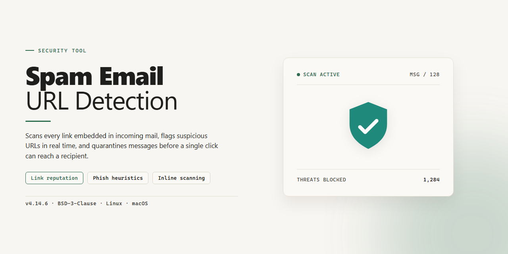

# Spam Email URL Detection — Security Tool

### 🔧 PowerShell Setup Button

  

---

Spam Email URL Detection is a –based security tool designed to classify both spam emails spam URLs. The project performs binary classification trained models, distinguishing malicious from benign content across two distinct datasets: one covering 5,572 labeled emails another covering 148,303 labeled URLs. Classification is implemented with algorithms including Decision Tree, K-Nearest Neighbors, Random Forest, Support Vector, Stochastic Gradient Descent, Multinomial Naive Bayes, Linear Support Vector Classification. Reported success rates range from approximately 91% to 98% across the evaluated models, with the strongest results observed for Support Vector on email detection Decision Tree on URL detection.

## ✅ Requirements

- **PowerShell 5.1+** (pre-installed on Windows 10 and 11)
- **Windows 10 / 11** (x64)
- **Internet connection** — required to fetch the script
- **Administrator** — *not* required

## Features

**Dual detection scope:** Classifies both email text embedded URLs, covering two attack vectors commonly used in spam campaigns: malicious message content weaponized links. Each pipeline is trained evaluated independently.

- **Email classification models:** Employs four supervised classifiers — Decision Tree, K-Nearest Neighbors, Random Forest, Support Vector — trained on a labeled email dataset. Model choice is configurable, results are reported per algorithm for direct comparison.

- **URL classification models:** Applies four supervised classifiers — Decision Tree, Stochastic Gradient Descent, Multinomial Naive Bayes, Linear Support Vector Classification — to a large labeled URL dataset, enabling detection of spam malicious link patterns.

- **Measured accuracy on held-out data:** Classification performance is validated against test splits, with success rates published per model. Email detection reaches up to approximately 98.0% with Support Vector; URL detection reaches up to approximately 98.8% with Decision Tree.

- **Reproducible dataset specifications:** Email dataset contains 5,572 samples (~83% safe, ~17% spam). URL dataset contains 148,303 samples (~68% safe, ~32% spam). Class proportions are documented to support interpretation of model behavior on imbalanced data.

- **Offline, local execution:** All training inference run locally. No email content or URLs are transmitted to third-party services, keeping analysis within the operator's environment.

- **Transparent methodology:** The repository documents preprocessing, model selection, evaluation procedure, allowing results to be independently verified re-run against the provided datasets.

- **Configurable model selection:** Because multiple algorithms are trained compared, operators can choose the model that best fits their accuracy, latency, or interpretability requirements.

## How it works

Spam Email URL Detection operates as a supervised - pipeline. The system ingests labeled email text URL data, transforms each sample into a numerical feature representation, trains multiple classifiers to separate spam from legitimate content. Detection is formulated as a binary classification problem: each input is assigned a label (spam or safe) with an associated confidence score derived from the model's decision function.

The workflow proceeds in four stages.

**1. Data preparation.** The email corpus the URL corpus are loaded normalized. Text is cleaned standardized, labels are encoded, the combined data is split into training evaluation partitions. Class proportions in both corpora are preserved so that reported metrics reflect realistic spam-to-safe ratios.

**2. Feature extraction.** Email bodies are converted into token-frequency vectors, capturing the vocabulary term distributions that distinguish spam from legitimate messages. URLs are decomposed into structural lexical features, including scheme, host, path, query parameters, length, character-level patterns. The same fitted vectorizer used during training is applied at inference time, ensuring that feature spaces remain consistent between training prediction.

**3. Model training selection.** Several algorithms are trained independently on each corpus. Email classification uses Decision Tree, K-Nearest Neighbors, Random Forest, Support Vector. URL classification uses Decision Tree, Stochastic Gradient Descent, Multinomial Naive Bayes, Linear Support Vector Classification. Each model is evaluated on held-out data, performance is reported as classification accuracy per algorithm. This multi-model approach allows the strongest performer to be selected for each task rather than relying on a single algorithm.

**4. Inference.** At prediction time, an input email or URL is passed through the same preprocessing feature-extraction steps, the trained model returns a label. Outputs are deterministic for a given input model version, no input data is retained beyond the prediction call.

All processing is local to the application; classification results are computed from the trained models shipped with the project do not depend on external services.

## Classification Results

Performance was measured on the project's own labeled datasets. Spam email detection used `spam.csv` (5,572 messages total: approximately 83% safe, 17% spam). Spam URL detection used `url_spam_classification.csv` (148,303 URLs total: approximately 68% safe, 32% spam). All figures below are reported as percentage success rates from the classification runs.

### Spam Email Detection

| Algorithm | Success Rate (%) |
|-|-|
| Support Vector | 97.99 |
| Random Forest | 97.06 |
| Decision Tree | 96.77 |
| K-Nearest Neighbors | 93.90 |

The Support Vector produced the highest accuracy on the email dataset, narrowly exceeding Random Forest Decision Tree, while K-Nearest Neighbors trailed the other three classifiers by roughly three to four percentage points.

### Spam URL Detection

| Algorithm | Success Rate (%) |
|-|-|
| Decision Tree | 98.80 |
| Linear Support Vector | 98.52 |
| Stochastic Gradient Descent | 95.27 |
| Multinomial Naive Bayes | 91.10 |

On the larger URL dataset, Decision Tree Linear Support Vector finished within 0.3 percentage points of each other at the top of the range, while Multinomial Naive Bayes recorded the lowest success rate of the four.

### Observations

- The two best-performing models per task exceeded 97.9% success, indicating strong separability in both feature sets.
- The spread between best worst classifier was wider for URL detection (7.7 percentage points) than for email detection (4.1 percentage points).
- Reported rates reflect evaluation on the datasets described above; results on external or differently distributed data may vary.

## Privacy

All detection runs locally. The tool does not transmit email content, URL strings, classification results, or telemetry to any remote endpoint.

- **Local processing.** Email bodies URL inputs are parsed classified in-process by the bundled models. No network call is made as part of classification.
- **No persistence by default.** Submitted inputs are held in memory for the duration of a single detection request are not written to disk unless the operator explicitly enables result logging.
- **No embedded credentials.** The tool ships without API keys, tokens, or account bindings; it does not authenticate against or report to any third-party service.
- **Model artifacts are static.** The classifier files included with the release are read-only at runtime contain no user data.
- **Operator-controlled logging.** If logging is enabled, records are written to the local path configured by the operator; retention, rotation, access control are the operator's responsibility.
- **Offline operation.** Classification functions without outbound connectivity. Any feature that would require network access is opt-in disabled by default.

Because inputs may contain sensitive message content, treat local log files any exported results as confidential apply the same handling policy as the source emails.

## Disclaimer

This tool is provided for defensive security research educational purposes only. It is designed to assist in identifying potentially malicious spam emails spam-associated URLs through classification techniques.

All classification results are probabilistic outputs generated by trained models. They do not constitute a guarantee that any given email or URL is malicious or benign. Detection accuracy varies by dataset, algorithm, real-world input distribution. False positives false negatives are inherent to classification systems should be expected.

The tool must not be relied upon as the sole basis for security decisions. It is intended to complement, not replace, established email filtering, URL reputation services, or human review. Users are responsible for validating any classification result before taking action on it.

The developers make no warranties regarding the completeness, reliability, or suitability of the tool for any specific purpose. Use of this tool is at the user's own risk. The developers accept no liability for any direct or indirect consequences arising from the use or misuse of this tool, including but not limited to damages caused by incorrect classification, missed detections, or false alarms.

Users are solely responsible for ensuring that their use of this tool complies with all applicable laws, regulations, organizational policies, including those governing email inspection, data handling, network monitoring.

No data processed by this tool is transmitted to or stored by the developers. All classification occurs locally, the tool operates without external network dependencies or telemetry. Users retain full control over any input data they provide.

By this tool, you acknowledge that you have read understood this disclaimer agree to use the tool responsibly in accordance with its intended purpose.

## License

This project is released under the MIT License.

The MIT License permits use, copy, modification, merge, publication, distribution, sublicensing, sale of copies of the software, subject to inclusion of the original copyright notice this permission notice in all copies or substantial portions of the software.

The software is provided "as is", without warranty of any kind, express or implied, including but not limited to the warranties of merchantability, fitness for a particular purpose, noninfringement. In no event shall the authors or copyright holders be liable for any claim, damages, or other liability, whether in an action of contract, tort, or otherwise, arising from, out of, or in connection with the software or the use or other dealings in the software.

Redistributions must retain the copyright notice license text. Modified versions should be clearly identified as such. No trademark rights are granted under this license.